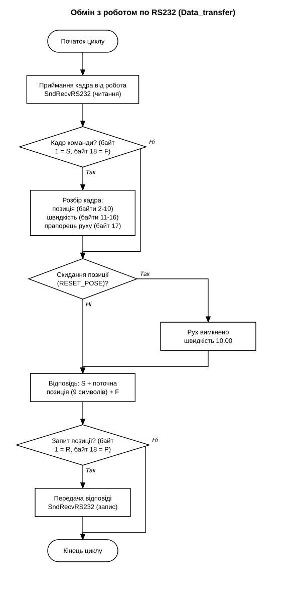
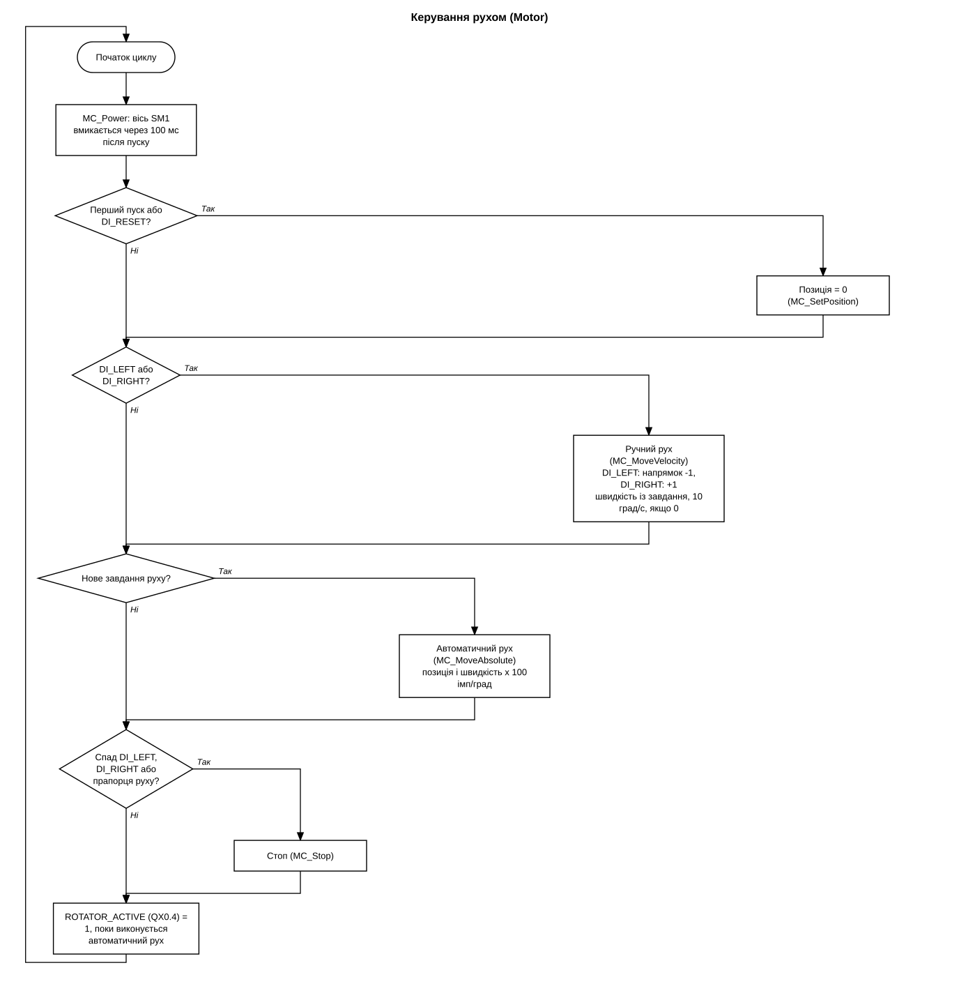

# Robot_Rotator_TM241

Керування обертачем від робота через контролер Schneider TM241 по інтерфейсу RS232.
Робот надсилає ASCII-кадри з позицією, швидкістю і командою руху. Контролер керує двигуном обертача через імпульсний вихід PTO і повертає роботу поточну позицію.

## Обладнання і ПЗ

| Вузол | Що |
|---|---|
| Контролер | Schneider Modicon TM241CEC24T |
| Робот | AIR10, контролер INCUBE 10, програма у файлах `.arl` |
| Зв'язок з роботом | RS232, Serial Line 1 контролера (RJ45), 4800 бод, 8 біт даних, 1 стоп-біт, без парності |
| Привід обертача | входи приводу PUL+ і DIR+ (імпульс і напрямок), вихід PTO контролера Q0 і Q1, вісь SM1, 100 імпульсів на градус |
| Середовище | SoMachine Logic Builder V4.3, мова Structured Text |

Електрична схема шафи керування: `docs/schematic.png`. Схема підключення робота до контролера: `docs/rs232-wiring.png`.

## Обмін по RS232

Команда руху від робота, 18 байт:

| Байти | Зміст |
|---|---|
| 1 | `S` |
| 2-10 | позиція в градусах зі знаком, формат `+00090.00` |
| 11-16 | швидкість у град/с, формат `360.00` |
| 17 | `1` рух, `0` стоп |
| 18 | `F` |

Запит позиції має ту саму довжину, байт 1 це `R`, байт 18 це `P`. Відповідь контролера складається з 11 байт: `S`, позиція (9 символів), `F`.

Діапазон позиції від -99999.99 до +99999.99 градусів, швидкості від 0 до 999.99 град/с. Гарантована частота обміну 100 мс (10 Гц). Розгін і гальмування двигуна плавні, прискорення 200 Гц/мс.

## Сигнали контролера

| Адреса | Змінна | Призначення |
|---|---|---|
| %IX0.1 | DI_LEFT | ручний рух у напрямку -1 |
| %IX0.2 | DI_RIGHT | ручний рух у напрямку +1 |
| %IX0.3 | DI_RESET | скидання позиції в 0, кнопка SA2 Reset pose на шафі |
| %QX0.0, %QX0.1 | Rotator PLS, Rotator DIR | імпульси PTO і напрямок для приводу |
| %QX0.4 | ROTATOR_ACTIVE | виконується автоматичний рух, подається на вхід DI4 робота |

## Програми контролера

| Файл | Призначення |
|---|---|
| `Main.st` | задає `SM1_RESOLUTION = 100` імпульсів на градус, викликає `Data_transfer` і `Motor` |
| `Data_transfer.st` | приймання кадрів, розбір позиції, швидкості й прапорця руху, формування відповіді з поточною позицією |
| `SndRecvRS232.st` | читання і запис по Serial Line 1, виконана в графічному редакторі (ADDM, SEND_RECV_MSG) |
| `Motor.st` | керування віссю SM1: ініціалізація, скидання позиції, ручний і автоматичний рух, стоп |
| `GVL.st` | входи, виходи, буфери обміну, змінні осі |

## Керування з програми робота

Модуль `robot/Rotator.arl` містить дві функції:

| Функція | Призначення |
|---|---|
| `Rotator::SET(move, pose, speed)` | надсилає команду: `move` дозвіл руху (`true` старт, `false` стоп), `pose` цільова позиція в градусах зі знаком, `speed` швидкість у град/с |
| `Rotator::GET_Pose()` | повертає поточну позицію в градусах (float) |

Приклад:

```
import "/USB/sda/Rotator.arl"

func void main()
print "GET pose = " + Rotator::GET_Pose() // deg
Rotator::SET(true, 90, 360) //move/stop, pose in deg, spd in deg/sec
endfunc
```

Файли `robot/Rotator_main.arl` і `robot/Rotator_test_10deg_waittime.arl` це приклади. Другий використовує вхід DI4 робота: поки `DI4 = true`, двигун зайнятий, нова команда не надсилається.

Особливості:

- Після завантаження контролера позиція скидається в 0. Те саме виконує фізична кнопка `DI_RESET`, при цьому швидкість повертається до значення за замовчуванням 10 град/с.
- Якщо скинути позицію під час руху, обертач сприймає поточне положення як 0 і рухається до заданої позиції.
- Ручний рух виконується клавішами F2 (вперед) і F3 (назад) на пульті робота. Швидкість 10 град/с за замовчуванням або остання, задана функцією `SET`.
- Позиція в команді може бути без крапки та без знаку (тоді знак `+`), з одним або двома знаками після крапки.

## Алгоритм

Обмін з роботом:



Керування рухом:



## Як відкрити

- Контролер: SoMachine Logic Builder V4.3, файл `PLC/ROTATOR.project`.
- Робот: скопіювати `robot/Rotator.arl` на флеш-накопичувач робота й підключити командою `import "/USB/sda/Rotator.arl"`. Якщо шлях не працює, використати `sda1`.

## Структура

```
PLC/ROTATOR.project   проєкт SoMachine
src/                  тексти програм контролера
robot/                модуль Rotator.arl і приклади програм робота
docs/                 електрична схема шафи, схема підключення робота, блок-схеми алгоритму
```
